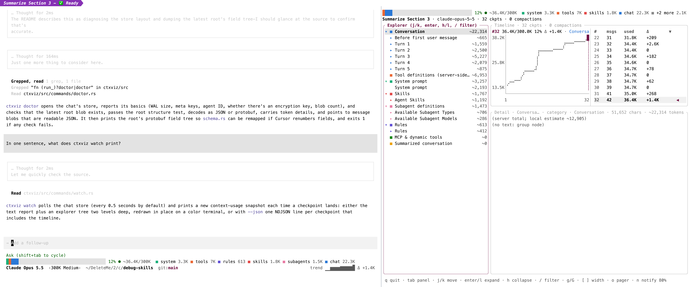
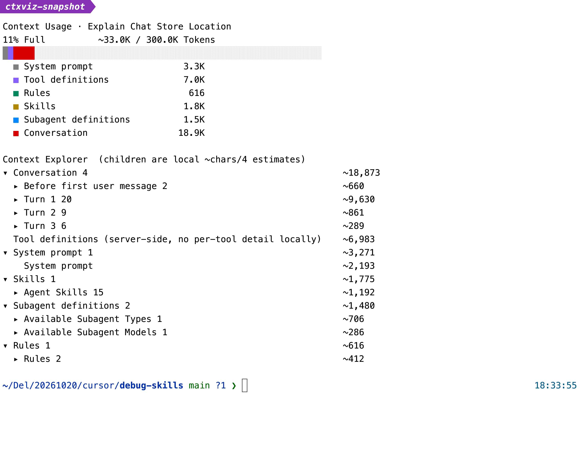
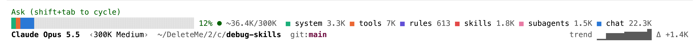

# ctxviz

Live context-window visualizer for interactive [Cursor CLI](https://cursor.com/cli) (`agent`) sessions.

ctxviz reads the chat store that the Cursor CLI writes on every checkpoint and shows you where your context window is going: how full it is, which categories (system prompt, tools, rules, skills, conversation) take the space, how usage grew turn by turn, and when compaction happened. It is one small Rust binary with two surfaces:

- **Status line**: a category-colored usage bar rendered inside the `agent` TUI, refreshed on every update.
- **Explorer TUI**: an interactive explorer tree, timeline chart, and detail pane that update live while the agent works. In Kitty it opens as a split next to the agent window.



*Left: an `agent` session with the ctxviz status line at the bottom. Right: `ctxviz tui`, opened with `ctxviz open`.*

## Requirements

| Need | Why | Check |
| --- | --- | --- |
| Rust toolchain (built with 1.89) | builds the binary | `cargo --version` |
| Cursor CLI (`agent`) | the sessions ctxviz visualizes | `agent --version` |
| macOS or Linux | reads `~/.cursor/chats` | |
| Kitty 0.49 or newer, optional | `ctxviz open`, tab colors, notifications | `kitty --version` |
| `python3` and `jq`, optional | only for the golden check against the Python reference | |

No Rust toolchain yet? Install it with [rustup](https://rustup.rs):

```sh
curl --proto '=https' --tlsv1.2 -sSf https://sh.rustup.rs | sh
```

If you prefer not to pipe a script into your shell, the rustup [other installation methods](https://rust-lang.github.io/rustup/installation/other.html) page has standalone installers with checksums. A package manager works too, for example `brew install rustup` on macOS or your distribution's `rustup` package on Linux.

## Install

```sh
git clone https://github.com/vykluong/ctxviz.git   # or git@github.com:vykluong/ctxviz.git over SSH
cd ctxviz
cargo install --path ctxviz --locked
ctxviz --version        # ctxviz 0.1.0
```

This puts `ctxviz` in `~/.cargo/bin`. Make sure that directory is on your `PATH` (rustup adds it for you).

## Quick start

### 1. Look at any chat right now

Run this from a directory where you have used `agent` before:

```sh
ctxviz snapshot
```



The header is the server-computed breakdown (what Cursor's own "Context Usage" panel shows). The Context Explorer below it is rebuilt locally from the message blobs, so child rows are `chars / 4` estimates and are marked with `~`.

Useful variations:

```sh
ctxviz snapshot --depth 3          # expand the explorer tree further (0 hides it)
ctxviz snapshot --latest           # most recently written chat in any workspace
ctxviz snapshot --cwd ~/code/app   # latest chat for another workspace
ctxviz snapshot --json | jq .percent
ctxviz snapshot --json | jq '.breakdown[] | [.label, .estimatedTokens]'
```

`snapshot` and `watch` take the same `--theme` and `--theme-file` flags as the status line (see [Themes](#themes)). They color only on a terminal unless you pass a theme explicitly, so piped output stays plain.

If you see `no cursor-agent chats for <dir>`, there is no store for that directory yet. Pass `--latest` or `--cwd`, or start `agent` there first.

### 2. Put the usage bar in the agent status line

Point the Cursor CLI at the binary. Edit `~/.cursor/cli-config.json` and add a `statusLine` block (replace `<you>` with your user name):

```json
"statusLine": {
  "type": "command",
  "command": "/Users/<you>/.cargo/bin/ctxviz statusline",
  "padding": 2
}
```

Then start a session and send one message:

```sh
cd ~/code/app
agent
```



The status line has two rows. At 118 columns it looks like this:

```
Claude Opus 5.5  ‹300K Medium›  ████████░░░░░░░░░░░░░░░░░░░░░░░░░░░░░░░░░░░░░░░░░░░░░░░░░░░░░░░░░░  ~36.4K/300K  11m
~/code/app  git:main  +41 −7                       ■ chat 22.3K  ■ tools 7K  ■ sys 3.3K
```

And at 64 columns:

```
Claude Opus 5.5  ‹300K Medium›  █░░░░░░░░░░░  ~36.4K/300K  11m
~/code/app  git:main  +41 −7     ■ chat 22.3K
```

What the rows mean:

1. **Usage.** The **model name** in bold, the parameter badge in `‹›` (for example `‹300K Medium›`), a **stacked bar** with one color per category, `~used/max` tokens, and the **session duration** since the chat store was created (`11m`, `1h 04m`). The bar takes every column the text does not need, so it grows with the terminal; both rows stop two cells short of the right edge. When fewer than 10 bar cells are left, the row drops the badge, then shortens the model to its family (`Opus 5.5`), then drops the duration.
2. **Place.** The shortened **workspace path** with the leaf in bold, `git:` plus the branch, and the working tree's line counts against `HEAD` as `+added −deleted` (omitted when clean). Right-aligned to the same edge: a **legend** with the three largest categories, largest first, each as a swatch, a short name (`sys`, `tools`, `rules`, `skills`, `mcp`, `agents`, `summary`, `chat`) and its token count. When the legend does not fit it shows two entries, then one, then none; the path shortens to its leaf before the branch is touched. Rows are cut, never wrapped.

Category colors follow the Cursor desktop Context Usage panel (gray system prompt, purple tools, ochre skills, magenta MCP, blue subagents, red-orange conversation) and only identify a category. Usage bands appear on the Kitty tab color and, in the other layouts, on the percent text.

The branch is read from `.git/HEAD`. The diff counts come from `git diff --shortstat HEAD`, run after a quick `git config` lookup of the repository's filter drivers; both calls share a 150 ms budget, after which git is killed and the counts are skipped, so a large working tree cannot stall the status line. Add `--no-git` to the command (or set `CTXVIZ_NO_GIT`, see [Files ctxviz writes](#files-ctxviz-writes)) to never run `git` or read `.git` in the workspace; the branch and diff counts are omitted. The command runs in about 10 ms on a typical store plus the git call, well inside the Cursor CLI's budget. If the store cannot be read it exits non-zero with no output, so Cursor keeps the previous text instead of showing a blank line. Before the first checkpoint the bar is single-colored, scaled from the payload's percent, and the legend and duration are absent.

`--layout classic` restores the previous two-row layout: the bar, the percent with its band glyph, `used/max` and the legend on row 1 (folding into `■ +n more` and swatches as the row narrows), then the model, badge, path, `git:branch` and a `trend` sparkline with `Δ` on row 2:

```
████░░░░░░░░░░░░░░░░░░░░░░░░░░░░░░░ 11% ● ~33K/300K  ■ system 3.3K ■ tools 7K ■ chat 18.9K ■ +3 more 3.9K
Claude Opus 5.5  ‹Medium›  ~/code/app  git:main                             trend ▁▁▂▂▃▅▅▆▆▇▇█ Δ +198
```

The glyph after the classic percent shows the usage band, and the percent text takes the same color:

| Glyph | Band | Remaining context |
| --- | --- | --- |
| `●` | good | more than 70% |
| `◐` | warn | more than 40% |
| `◑` | low | more than 20% |
| `○` | critical | 20% or less |

`--bar labeled` paints each category segment as a solid background block and writes its short name (for example `tools` or `chat`) inside the segment when it is wide enough, so the bar labels itself. It relies on background colors, so check that it renders in your Cursor build before relying on it. The `none` theme falls back to the plain bar.

For a single row, add `--rows 1` to the command (`ctxviz statusline --rows 1`). It keeps the bar, the percent, `used/max`, the model, the `‹effort›` badge, the trend with its `Δ`, and the classic legend, but never shows the path or the git branch. When the row is too narrow it folds the legend, shows swatches only, drops the legend, then drops the `Δ`, the trend, the badge, and `used/max`, and finally shrinks the bar.

#### Themes

`statusline`, `tui`, `notify-test`, and `open` (which forwards them to the TUI) accept the same theme flags. `--theme <value>` beats the `CTXVIZ_THEME` environment variable, which beats auto detection. `snapshot` and `watch` take the same flags but color only on a terminal unless `--theme` or `--theme-file` is passed explicitly. Values:

- `auto`: detect (the default).
- `light`, `dark`: Modus Operandi or Modus Vivendi.
- A family name (`modus`, `catppuccin`, `rose-pine`, `tokyo-night`, `gruvbox`): picks the light or dark preset by detection.
- `<family>-light`, `<family>-dark`: a specific preset, for example `catppuccin-dark`.
- `ansi`: the terminal's 16 colors.
- `none`: no color.

| Family | Light preset | Dark preset |
| --- | --- | --- |
| `modus` (default) | Modus Operandi | Modus Vivendi |
| `catppuccin` | Latte | Mocha |
| `rose-pine` | Dawn | Rosé Pine |
| `tokyo-night` | Day | Night |
| `gruvbox` | Light | Dark |

Auto detection checks, in order:

1. `NO_COLOR` (non-empty) or `TERM=dumb`: no color. These win even over `--theme`.
2. `COLORTERM` other than `truecolor` or `24bit`: `ansi`.
3. `TERM_THEME=light` or `TERM_THEME=dark` (Kitty exports it).
4. The background field of `COLORFGBG`.
5. Otherwise light.

When `TERM_THEME` is unset, the TUI additionally asks the terminal for its background color (OSC 11) before falling back to `COLORFGBG`.

To match any Kitty color scheme, pass `--theme-file <path/to/kitty.conf>` instead of `--theme`. ctxviz reads `foreground`, `background`, and `colorN`. If the file's background and foreground match a built-in preset it uses that preset; otherwise it derives the chrome colors from the file.

The status line never queries the terminal. When detection picks wrong, set `CTXVIZ_THEME` or pass the flag in `cli-config.json`:

```json
"command": "/Users/<you>/.cargo/bin/ctxviz statusline --theme dark"
```

### 3. Open the interactive explorer

```sh
ctxviz tui                 # latest chat for the current directory
ctxviz tui --latest        # or the most recent chat anywhere
```

The TUI watches the store and redraws when a checkpoint lands, so run it in a second terminal while `agent` works. Two flags change the layout:

```sh
ctxviz tui --split 50          # explorer takes 50% of the width
ctxviz tui --timeline-rows 12  # timeline is 12 rows tall
```

By default the explorer is 36 columns or 35% of the width, whichever is wider, and the timeline is 35% of the body height (between 10 and 16 rows). At 118 columns it looks like this:

```
████░░░░░░░░░░░░░░░░░░░░░░░░░░░░░░░ 11% ● ~33K/300K  ■ system 3.3K ■ tools 7K ■ chat 18.9K ■ +3 more 3.9K
Example chat · claude-opus-5-5 · 17 ckpts · 0 compactions
╭ Explorer ─────────────────────────────╮╭ Timeline · 17 ckpts · 0 compactions ──────────────────────────────────────╮
│▾ ■ Conversation                ~18,873││#17 33.0K/300.0K 11% Δ +198 · Convers│ #    msgs   used     Δ        ▼     │
│  ▸ Before first user message      ~660││34.6K│                ⢀⣀⠤⠤⠤⠤⠤⠤⠤⠤⠤⠤⠤⠤⢲│ 11   19     32.0K    +1.1K          │
│  ▾ Turn 1                       ~9,630││     │        ⡠⠊⠉⠉⠉⠉⠉⠉⠁             ⢸│ 12   20     32.0K    0              │
│      User Message                  ~58││24.1K│ ⢀⠖⠒⠒⠒⠊⠉                      ⢸│ 13   21     32.2K    +159           │
│      Tool: Read                    ~20││     │⢀⠎                            ⢸│ 14   22     32.2K    0              │
│      Tool Result: Read            ~936││13.6K│⠎                             ⢸│ 15   24     32.5K    +329           │
│  ▸ Turn 2                         ~861││     └───────────────────────────────│ 16   26     32.8K    +286           │
│  ▸ Turn 3                         ~289││     1                             17│ 17   27     33.0K    +198        ◀  │
│  ■ Tool definitions (server-si… ~6,983│╰─────────────────────────────────────┴─────────────────────────────────────╯
│▸ ■ System prompt                ~3,271│╭ Detail · User Message · message · Conversation · 231 chars · ~58 tokens ──╮
│▸ ■ Skills                       ~1,775││<user_query>                                                               │
╰───────────────────────────────────────╯╰───────────────────────────────────────────────────────────────────────────╯
 q quit · tab panel · j/k move · enter/l expand · h collapse · / filter · g/G · [ ] width · o pager · n notify 80%
```

What each part shows:

- **Header** (top, no border): row 1 is the status line's first row, built by the same code, so the bar, percent, and legend always agree with the agent's status line. Row 2 is the chat name, the model, and the number of checkpoints and compactions.
- **Explorer** (left): the context tree. Top-level rows carry a `■` swatch in their category color, the same color the header bar and legend use. Expand a conversation turn to see every message, tool call, and tool result with its token estimate.
- **Timeline** (top right): a summary of the selected checkpoint, a chart of used tokens per checkpoint, and a table with one row per checkpoint (`#`, `msgs`, `used`, `Δ`, `▼`). Compactions are marked `▼` in the summary, the table, and on the chart's x axis. The selected checkpoint has `◀` in the table and a vertical line in the chart. When the panel is narrower than 60 columns inside, the table moves below the chart. With fewer than 8 rows inside, it shows only the summary and a sparkline.
- **Detail** (bottom right): the selected node's text. The panel title carries its label, kind, category, character count, and token estimate.

Keys:

| Key | Action |
| --- | --- |
| `j` / `k`, arrows | move (explorer or timeline, depending on focus) |
| `enter` / `l` | expand the node, or step into it when already open |
| `h` | collapse, or jump to the parent |
| `g` / `G` | first / last row |
| `/` | filter the explorer by label (`esc` clears) |
| `tab` / `shift+tab` | cycle focus: explorer, timeline, detail |
| `[` / `]` | narrow or widen the explorer by 4 columns (from any panel, not while typing a filter) |
| `J` / `K` | scroll the detail pane by one line (from the explorer or the detail pane) |
| `PgUp` / `PgDn` | move the explorer selection by 10 rows, or scroll the detail pane by 10 lines when it has focus |
| `o` | open the selected node's text in `$PAGER` (Kitty overlay) |
| `n` | cycle the notification threshold: 80%, 90%, 95%, off |
| `q`, `ctrl+c` | quit |

The explorer stays between 24 columns and 80% of the width. The width you set with `[` and `]` is remembered in `~/.cursor/ctxviz/tui.json` for the next run, and `--split` overrides it.

### 4. Kitty: one key to open the explorer next to the agent

Kitty integration needs remote control. Add these two lines to `~/.config/kitty/kitty.conf` and restart Kitty:

```conf
allow_remote_control socket-only
listen_on unix:${XDG_RUNTIME_DIR}/kitty
```

ctxviz only talks to Kitty over the socket, so `socket-only` is enough; `yes` would also let escape sequences in any program's output drive Kitty. Put the socket in a directory only you can read. `XDG_RUNTIME_DIR` is private (mode 0700) on most Linux systems, but on macOS it is usually unset; there, create a private directory first (`mkdir -m 700 ~/.local/run`) and use `listen_on unix:/Users/<you>/.local/run/kitty`. A path such as `unix:/tmp/kitty-$USER` is still visible to every user on the machine.

Check it works with `kitten @ ls`, which should print JSON. Then, from the Kitty tab where `agent` is running (or from any shell in that Kitty instance):

```sh
ctxviz open            # opens the TUI in a split next to the agent, keeps the agent focused
ctxviz open --focus    # same, but focus the split if it is already open
```

`ctxviz open` finds the agent window and the chat store from `~/.cursor/ctxviz/current.json`, which the status line writes on every update. So the status line must be configured first, and the agent must have rendered at least once.

For a keyboard shortcut, add to `kitty.conf`, replacing the path with the output of `command -v ctxviz`:

```conf
map cmd+shift+c launch --type=background --allow-remote-control /Users/you/.cargo/bin/ctxviz open
```

Both parts matter. A background launch does not inherit your shell's `PATH` (Kitty started from the Dock or Finder sees only the system `PATH`), so a bare `ctxviz` is not found. It also gets no `KITTY_LISTEN_ON` unless `--allow-remote-control` is given, which hands it a private remote control socket.

Notes:

- The split is placed with `--location=vsplit`. For a true side-by-side split the tab must use Kitty's `splits` layout; other layouts (`fat`, `tall`, `stack`) place the new window wherever that layout decides. Switch a tab with `kitten @ goto-layout splits`, or put `splits` first in `enabled_layouts`.
- Running `ctxviz open` twice does not open a second split. It reports the existing window id.

While the status line runs inside Kitty it also colors the agent's tab when usage crosses 80% (orange) and 90% (red), with hysteresis so the color does not flap. The TUI sends a desktop notification on the same crossings (threshold set with `n`) and shows a progress indicator in the tab while a checkpoint is less than two seconds old. Try all three without waiting for a real 85% session:

```sh
ctxviz notify-test --percent 85    # tab turns orange, notification fires
ctxviz notify-test --percent 95    # tab turns red
ctxviz notify-test --percent 10    # back to the theme color
```

## Other commands

### Stream snapshots as they happen

```sh
ctxviz watch                         # re-renders the snapshot on every checkpoint
ctxviz watch --json | jq -c '{percent, used: .usedTokens}'
ctxviz watch --json --interval 1 >> usage.ndjson
```

Text mode clears the screen and redraws. JSON mode emits one line per checkpoint (NDJSON) and includes the `timeline`, so it is handy for logging a long session.

### Diagnose a store

```sh
ctxviz doctor
```

Prints the resolved store path, meta keys, blob counts, whether the latest root passes the structural checks, and a field-by-field dump of the root protobuf. Run it first if `snapshot` prints nothing useful after a Cursor update; the field numbers it shows are what `ctxviz/src/schema.rs` has to match.

### Choosing which chat to read

`snapshot`, `watch`, `tui`, and `doctor` share the same selectors:

| Flag | Picks |
| --- | --- |
| none | the most recently written chat for the current directory |
| `--cwd <dir>` | the most recently written chat for that workspace |
| `--latest` | the most recently written chat in any workspace |
| `--chat <agentId>` | that chat, found by id across all workspaces |
| `--chat <path/to/store.db>` | that file directly |

An agent id must match `[A-Za-z0-9._-]{1,128}` and must not start with a dot; anything else is rejected unless it names an existing file, which is opened directly. The same rule applies to the status line payload's `session_id`.

Stores live at `~/.cursor/chats/<md5 of workspace path>/<agentId>/store.db`.

## Files ctxviz writes

Every file ctxviz writes lives in its state dir, `~/.cursor/ctxviz` by default:

| Path in the state dir | Purpose |
| --- | --- |
| `current.json` | session the status line last saw: session id, store path, cwd, Kitty window id, model |
| `tui.json` | TUI layout remembered across runs: explorer width set with `[` and `]` |
| `open.log` | one line per failed `ctxviz open` (background launches have no window for stderr), rotated to `open.log.1` past 256 KiB |
| `<agentId>.json` | timeline cache: checkpoints, last scanned rowid, last notified band (an id that fails the [id rules](#choosing-which-chat-to-read) gets a hashed `invalid-<md5>.json` name instead) |
| `pager/` | short-lived temp files for the TUI's `o` key, mode 0600, deleted after the pager exits |

New directories are created with mode 0700 and files with mode 0600. Deleting any of these files is safe; the next run rebuilds what it needs from the store.

Environment variables:

- **`CTXVIZ_STATE_DIR`**: when set and non-empty, moves the whole state dir, so every file above (`current.json`, `tui.json`, `open.log`, the timeline caches, and `pager/`) goes there instead.
- **`CTXVIZ_NO_GIT`**: any value other than empty, `0`, or `false` (any case) acts like `--no-git` on the status line.
- **`CTXVIZ_THEME`**: the default theme (see [Themes](#themes)).

Outside the state dir, the only files that appear because of ctxviz are SQLite's `store.db-wal` and `store.db-shm` sidecars next to a chat store (see [Privacy and security](#privacy-and-security)).

## Privacy and security

ctxviz runs entirely on your machine. It makes no network connections and has no telemetry, so nothing from your chats leaves the machine.

- **Reads.** Cursor chat stores under `~/.cursor/chats`, opened read-only with SQLite's defensive mode, `trusted_schema` off, and `query_only` on. It also reads the status line payload on stdin, its own state files, `.git/HEAD` in the workspace, and a `--theme-file` when you pass one.
- **Writes.** The files listed in [Files ctxviz writes](#files-ctxviz-writes), under `~/.cursor/ctxviz` or `$CTXVIZ_STATE_DIR`. ctxviz never modifies a chat store.
- **SQLite sidecars.** Opening a WAL-mode store, even read-only, makes SQLite create `store.db-wal` and `store.db-shm` next to it in `~/.cursor/chats/...` when they are missing, and they stay after ctxviz exits. This is the only write ctxviz causes outside its state dir. The Cursor CLI leaves the same two files while a chat is live.
- **Pager files.** Pressing `o` in the TUI writes the selected node's sanitized text to a randomly named file with mode 0600 under `<state dir>/pager/`. The shell in the Kitty overlay deletes it after the pager exits. Files older than one hour, left behind when the overlay never finished, are swept when the TUI starts.
- **Runs `git`.** It runs in the workspace for the diff counts with a cleared environment (only `PATH` and `HOME` kept), `GIT_CONFIG_GLOBAL=/dev/null`, and `GIT_CONFIG_NOSYSTEM=1`, so your global and system git config, including aliases, are ignored. Command-line overrides disable hooks, fsmonitor, the external diff, the git pager, and `core.attributesFile`. Textconv is off, and every `filter.<driver>` clean, smudge, and process command is replaced with a no-op. Both git calls share a 150 ms budget. Turn git off with `--no-git` or `CTXVIZ_NO_GIT=1`.
- **Runs Kitty and your pager.** Inside Kitty it runs `kitten @` over the `KITTY_LISTEN_ON` socket. When you press `o`, the overlay runs `$PAGER` as the TUI sees it (default `less`). The value is passed to the overlay with `kitten @ launch --env` and is never spliced into the shell script, so shell syntax in it is not evaluated; it is only split into words, so `less -R` still works.
- **Terminal output.** Chat text is sanitized before it is printed: control characters become U+FFFD, so a chat cannot send escape sequences to your terminal.

See [SECURITY.md](SECURITY.md) for the threat model, accepted risks, and how to report a vulnerability.

## Troubleshooting

- **Status line is blank or stale.** Run the command by hand with a sample payload and look at stderr:

  ```sh
  echo '{"session_id":"<id>","cwd":"'"$PWD"'","model":{"display_name":"Opus"},"context_window":{"used_percentage":25,"context_window_size":200000},"render_width_chars":120}' | ctxviz statusline
  ```

  Any `ctxviz statusline: ...` message on stderr is the reason it exited non-zero.
- **`chat has no checkpoint yet`.** The chat exists but the agent has not completed a turn. Send a message and retry.
- **`ctxviz open: not in Kitty`.** `KITTY_LISTEN_ON` is not set in that shell. Check the `listen_on` line in `kitty.conf` and restart Kitty.
- **The `kitty.conf` shortcut does nothing.** A background launch has no window, so its errors are invisible. Every failed `ctxviz open` appends a line to `~/.cursor/ctxviz/open.log`; read it with `tail ~/.cursor/ctxviz/open.log`. A `not in Kitty` line means the mapping lacks `--allow-remote-control`. If Kitty shows a "Failed to run background process" window instead, use the absolute path to `ctxviz` (see section 4).
- **`ctxviz open: current session has no store path`.** The status line has not seen a checkpoint for the session yet. Send a message in the agent, then retry.
- **Numbers look wrong after a Cursor upgrade.** Run `ctxviz doctor`; if the structural root test fails, the protobuf field numbers moved.

## Development

```sh
cd ctxviz
cargo build --release          # ./target/release/ctxviz
cargo test                     # unit tests plus the fixture golden test
scripts/golden-diff.sh --latest   # compare against the Python reference on a live chat
```

`scripts/context_usage.py` at the repo root is the Python reference implementation and the oracle for the golden test: `ctxviz snapshot --json` must match its `--json` output except for the extra `timeline` key. See [`ctxviz/README.md`](ctxviz/README.md) for the crate layout, fixtures, and verification steps, and [`docs/store-format.md`](docs/store-format.md) for the chat store layout it reads.

## License

Licensed under either of [Apache License, Version 2.0](LICENSE-APACHE) or [MIT license](LICENSE-MIT) at your option.

Unless you explicitly state otherwise, any contribution intentionally submitted for inclusion in the work by you, as defined in the Apache-2.0 license, shall be dual licensed as above, without any additional terms or conditions. See [CONTRIBUTING.md](CONTRIBUTING.md) for how to contribute.
